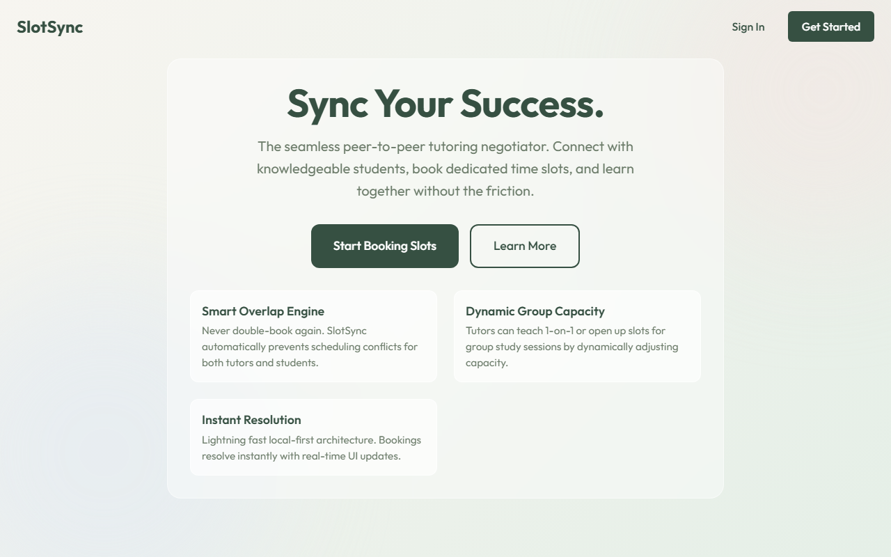
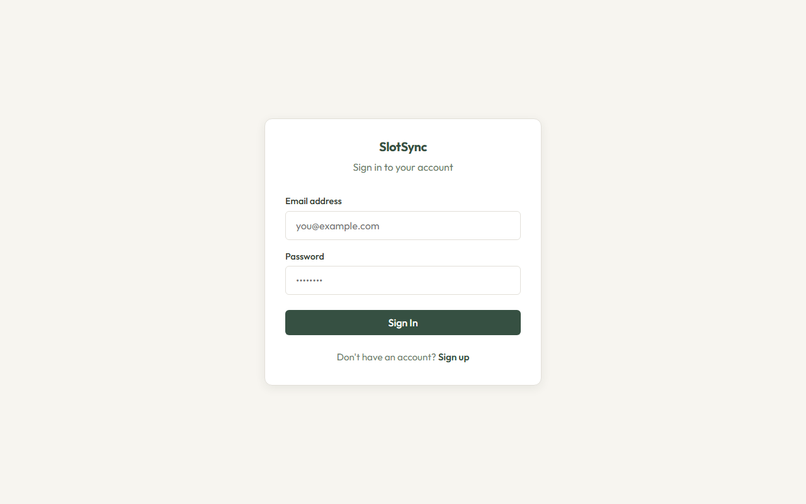
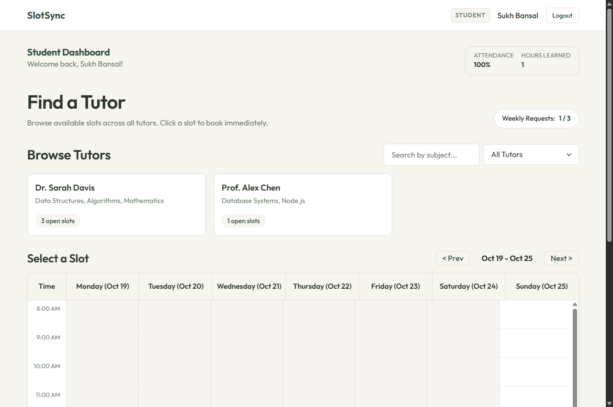
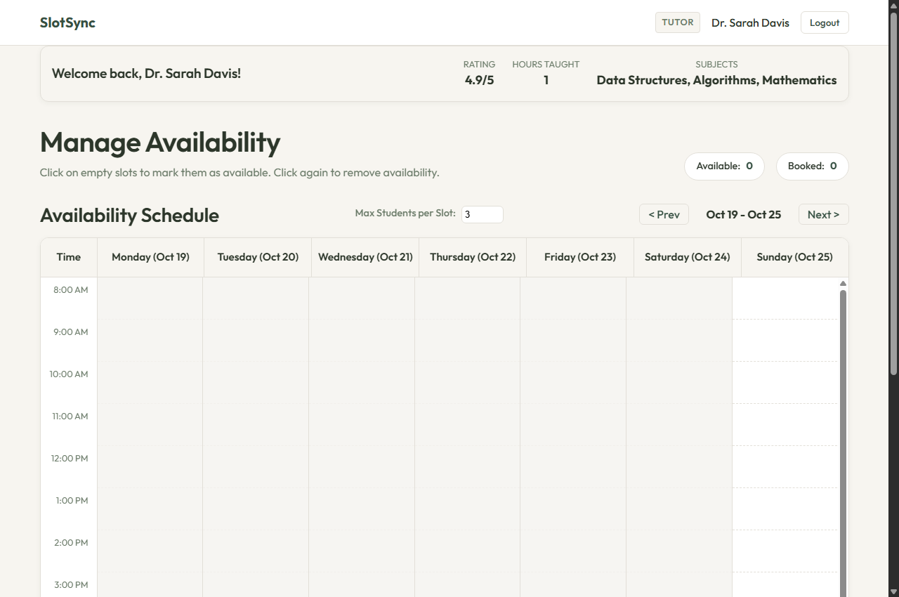

# SlotSync - Peer-to-Peer Tutoring Slot Negotiator

[](https://nodejs.org/)
[](https://expressjs.com/)
[](https://www.mongodb.com/)
[](https://developer.mozilla.org/en-US/docs/Web/JavaScript)
[](https://render.com/)
[](https://www.postman.com/)

An educational full-stack scheduling and slot-negotiation platform connecting peer tutors and students. The application eliminates scheduling friction, prevents double-booking, enforces fairness limits, allows students to attach study topics and reference materials, and provides tutors full approval control over incoming requests.

---

## Application Screenshots

### Landing Page


### Authentication Portal


### Student Dashboard


### Tutor Availability Management


---

## Key Features

### For Students
- Interactive Calendar: Visual weekly schedule grid starting Monday and ending Sunday for browsing available slots across all tutors.
- Tutor and Subject Filtering: Search and filter tutors by subject area such as Data Structures, Mathematics, and Database Systems.
- Detailed Slot Requests: When requesting a slot, students submit the topic to study, specific notes, and reference files.
- Fairness Quota Protection: Automated limit of active requests per student to prevent slot hoarding.
- Overlap Prevention: Conflict engine prevents booking overlapping time slots on the same calendar day.
- Status Tracking: Real-time visibility into booking statuses (Pending Approval, Confirmed, Declined).

### For Tutors
- One-Click Availability: Click calendar cells to mark hours as open or remove them.
- Past Date Lock: Automatically prevents creating or displaying slots for dates in the past.
- Custom Group Capacity: Configure group size per slot from 1 to 10 students.
- Request Negotiation and Review: Incoming requests appear under pending reviews with student notes and topics.
- Accept or Decline Control: Tutors maintain explicit approval control before any booking is confirmed.

---

## Project Repository Structure

```text
peer-to-peer-tutoring-slot-negotiator/
├── backend/                         # REST API Server (Node.js, Express, MongoDB)
│   ├── config/
│   │   └── db.js                    # Mongoose database connection with environment fallback
│   ├── controllers/
│   │   ├── authController.js        # User register, login, and profile logic
│   │   ├── slotController.js        # Slot queries, availability toggling, and deletion
│   │   ├── bookingController.js     # Booking creation, approval, rejection, and cancellation
│   │   ├── userController.js        # Tutor discovery and capacity updates
│   │   └── systemController.js      # Server health check and database status
│   ├── middleware/
│   │   ├── auth.js                  # JWT token verification and role protection guard
│   │   └── errorHandler.js          # Centralized JSON error handling
│   ├── model/
│   │   ├── User.js                  # User schema with bcrypt password hashing
│   │   ├── Slot.js                  # Availability slot schema
│   │   └── Booking.js               # Booking negotiation lifecycle schema
│   ├── routes/                      # Modular Express Routers
│   │   ├── auth.routes.js           # /api/auth endpoints
│   │   ├── slots.routes.js          # /api/slots endpoints
│   │   ├── bookings.routes.js       # /api/bookings endpoints
│   │   └── users.routes.js          # /api/users endpoints
│   ├── .env.example                 # Example environment variables template
│   ├── index.js                     # Express server entry point (serves API and frontend)
│   └── package.json                 # Backend dependencies and scripts
│
├── frontend/                        # Client-Side Application (HTML5, Vanilla CSS, JS)
│   ├── css/
│   │   └── style.css                # Custom design system, color tokens, and calendar grid
│   ├── js/
│   │   ├── auth.js                  # Authentication logic and session controller
│   │   ├── data.js                  # Client datastore and local state manager
│   │   ├── student.js               # Student calendar, booking modal, and status tracker
│   │   ├── tutor.js                 # Tutor availability scheduler and request review
│   │   └── toast.js                 # Toast notification system
│   ├── index.html                   # Modern landing page
│   ├── login.html                   # Login and registration portal
│   ├── student.html                 # Student dashboard interface
│   └── tutor.html                   # Tutor dashboard interface
│
├── screenshots/                     # Application screenshots for documentation
│   ├── landing.png
│   ├── login.png
│   ├── student_dashboard.png
│   └── tutor_dashboard.png
│
├── package.json                     # Root package configuration for cloud platforms
├── .gitignore                       # Git exclusion rules
└── README.md                        # Project documentation
```

---

## Technology Stack

| Layer | Technologies Used |
| :--- | :--- |
| Frontend UI | HTML5 Semantic Markup, Vanilla CSS3 (Custom Design Tokens, Flexbox, Grid), JavaScript (ES6+) |
| Frontend Storage | Browser LocalStorage (Phase 1 / CA-1 offline-first storage) |
| Backend Runtime | Node.js (version 18 or higher) |
| Backend Framework | Express.js 4.x with Modular Routers |
| Database | MongoDB with Mongoose 8.x ODM |
| Security and Auth | JSON Web Tokens (jsonwebtoken), Password Hashing (bcryptjs), CORS (cors), Environment Config (dotenv) |
| Deployment | Render Web Service (unified backend and frontend static hosting) |
| API Testing | Postman Desktop Application |

---

## REST API Reference

Base URL: `http://localhost:5000` (Local) or your Render deployment URL.

### 1. System Health
| Method | Endpoint | Access | Description |
| :--- | :--- | :--- | :--- |
| GET | `/api/system/health` | Public | Check server uptime and MongoDB connection state |

### 2. Authentication
| Method | Endpoint | Access | Description |
| :--- | :--- | :--- | :--- |
| POST | `/api/auth/register` | Public | Register a new user (student or tutor) |
| POST | `/api/auth/login` | Public | Authenticate user and receive JWT Bearer token |
| GET | `/api/auth/me` | Private | Get profile details of currently authenticated user |

### 3. Slots Management
| Method | Endpoint | Access | Description |
| :--- | :--- | :--- | :--- |
| GET | `/api/slots/available` | Public | View all available tutoring slots |
| GET | `/api/slots/my` | Private (Tutor) | Get slots created by the logged-in tutor |
| POST | `/api/slots/toggle` | Private (Tutor) | Toggle slot availability (locked for past dates) |
| DELETE | `/api/slots/:id` | Private (Tutor) | Cancel and remove an availability slot |

### 4. Bookings and Negotiation
| Method | Endpoint | Access | Description |
| :--- | :--- | :--- | :--- |
| POST | `/api/bookings` | Private (Student) | Request slot with topic, specifics, and attachment |
| GET | `/api/bookings/my` | Private | View user requested and assigned sessions |
| PATCH | `/api/bookings/:id/status` | Private (Tutor) | Accept (confirmed) or decline (rejected) request |
| POST | `/api/bookings/:id/cancel` | Private | Cancel active booking |

### 5. Users and Tutors
| Method | Endpoint | Access | Description |
| :--- | :--- | :--- | :--- |
| GET | `/api/users/tutors` | Public | Discover tutors with subject filtering |
| PATCH | `/api/users/capacity` | Private (Tutor) | Update maximum student capacity per slot |

---

## Local Setup and Installation

### Prerequisites
- Node.js (version 18 or higher)
- MongoDB installed locally on port 27017 or a MongoDB Atlas connection string
- Postman (for API endpoint testing)

### 1. Clone Repository
```bash
git clone https://github.com/namha-alt/peer-to-peer-tutoring-slot-negotiator.git
cd peer-to-peer-tutoring-slot-negotiator
```

### 2. Configure Environment
Create a `.env` file inside the `backend` folder:
```env
PORT=5000
MONGODB_URI=mongodb://127.0.0.1:27017/slotsync_db
JWT_SECRET=slotsync_super_secret_jwt_key_2026_express_mongo
NODE_ENV=development
```

### 3. Install Dependencies
```bash
cd backend
npm install
```

### 4. Start the Application
```bash
npm run dev
```
For production run:
```bash
npm start
```

### 5. Access the Web Application
Open `http://localhost:5000` in your browser. The Express server automatically serves the frontend static client while simultaneously handling all REST API calls under `/api`.

---

## Cloud Deployment (Render)

The application is structured for single-service full-stack deployment on Render. The Express server serves both the frontend client interface and the backend REST API from a single unified host.

### Deployment Configuration
1. Create a new Web Service on Render and connect this repository.
2. Set the following build and start parameters:
   - Environment: `Node`
   - Build Command: `cd backend && npm install`
   - Start Command: `cd backend && node index.js`
3. Add the required Environment Variables in the Render dashboard:
   - `MONGODB_URI`: Your MongoDB Atlas connection URI (`mongodb+srv://...`)
   - `JWT_SECRET`: A secure random secret string
   - `NODE_ENV`: `production`
4. Deploy the service. Render will start the Express server and serve the entire application at your assigned `.onrender.com` domain.

---

## Git Branching Strategy

| Branch | Description |
| :--- | :--- |
| `main` | Production full-stack application with unified backend and frontend. |
| `feature/ca1-frontend-vanilla` | Standalone Vanilla HTML, CSS, and JS frontend with LocalStorage (Phase 1 / CA-1). |
| `feature/ca2-backend-api` | Modular Express REST API with MongoDB, Mongoose, and Postman tests (Phase 2 / CA-2). |
| `feature/booking-negotiation-flow` | Topic selection, PDF attachment, and tutor accept and decline flow. |
| `sukh-1705/frontend-ui` | Frontend UI components, student dashboard, and responsive styling (@Sukh-1705). |
| `rudar-teach/slot-negotiation` | Tutor calendar grid, slot availability, and negotiation routes (@Rudar-teach). |
| `namha-alt/auth-integration` | System architecture, authentication guards, and full-stack integration (@namha-alt). |

---

## Team and Work Distribution

| Contributor | GitHub | Role | Key Contributions |
| :--- | :--- | :--- | :--- |
| Namha | [@namha-alt](https://github.com/namha-alt) | Lead and Full-Stack Architect | Project architecture, authentication module, JWT authorization guards, Mongoose DB connection, auth routes, and error handling. |
| Sukdev Bansal | [@Sukh-1705](https://github.com/Sukh-1705) | Frontend Engineer and UI/UX | Design system tokens, landing page, student dashboard, tutor search and subject filters, booking request modal, UI polish, and documentation. |
| Rudar | [@Rudar-teach](https://github.com/Rudar-teach) | Backend and Features Engineer | Tutor dashboard and calendar grid, slot persistence, Slot and Booking Mongoose models, slot controller, and booking negotiation API. |

---

## License

ISC License - Created for academic demonstration and evaluation.